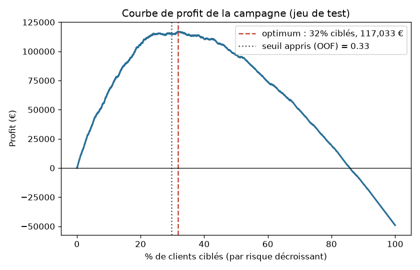
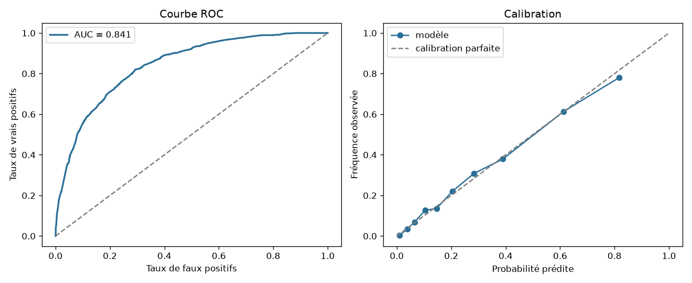
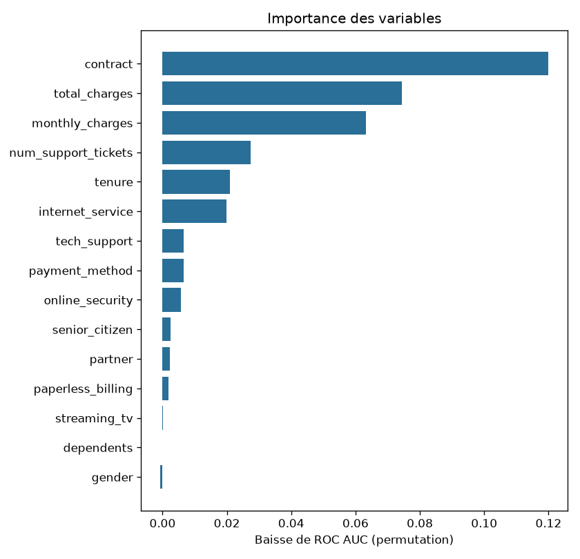

# 💰 ChurnProfit

**Prédire le churn, oui — mais surtout savoir _qui_ appeler pour gagner de l'argent.**

La plupart des projets de churn s'arrêtent à l'AUC. ChurnProfit va jusqu'à la décision
business : à partir de probabilités **calibrées** et du coût réel d'une campagne de
rétention, il produit la liste des clients à cibler qui **maximise le profit**.

| Stratégie (jeu de test, 4 000 clients) | Profit |
|---|---|
| Ne cibler personne | 0 € |
| Cibler tout le monde | −49 048 € |
| Cibler au hasard (même volume) | −14 466 € |
| **ChurnProfit** (31 % des clients ciblés) | **+118 847 €** |
| Oracle (borne supérieure) | 217 622 € |



## Le problème métier

Chaque client ciblé par la campagne coûte un contact (10 €) et se voit offrir une remise
(80 €). Un churner ciblé accepte l'offre et reste avec une probabilité de 30 % : on sauve
alors 12 mois de facturation. Un client fidèle ciblé, lui, empoche la remise pour rien.

Gain espéré de cibler le client *i*, de probabilité de churn *pᵢ* et de valeur *Vᵢ* :

```
E[gain] = pᵢ · accept_rate · (Vᵢ − remise)  −  (1 − pᵢ) · remise  −  coût_contact
```

On cible ssi `E[gain] > 0`. Cette règle tient compte de la **valeur propre à chaque
client** (un gros abonné à risque modéré peut valoir plus qu'un petit à haut risque) et
n'est optimale que si les probabilités sont fiables — d'où la calibration isotonique.

## Méthodologie

1. **Données** : jeu synthétique réaliste de 20 000 clients télécom (effets non linéaires,
   interactions, valeurs manquantes), au même format que le dataset public
   [Telco Customer Churn](https://www.kaggle.com/datasets/blastchar/telco-customer-churn).
   Pour utiliser le vrai dataset, renseignez `data.path` dans `configs/config.yaml`.
2. **Feature engineering** (`ChurnFeatures`) : facture moyenne historique, tendance de la
   facture, ancienneté logarithmique, nouveau client, nombre de services souscrits.
3. **Préprocessing** dans un `Pipeline` scikit-learn (imputation + indicateurs de valeurs
   manquantes, standardisation, one-hot) : aucune fuite de données entre les folds.
4. **Modèles candidats** : régression logistique, random forest, gradient boosting
   (`HistGradientBoostingClassifier`), tous calibrés (`CalibratedClassifierCV`, isotonic).
5. **Sélection par le profit**, pas par l'AUC : validation croisée stratifiée 5 folds,
   prédictions out-of-fold, comparaison de deux politiques (seuil optimisé vs. espérance
   de gain).
6. **Évaluation** sur un jeu de test jamais vu : ROC/PR AUC, Brier, lift, calibration,
   profit vs. stratégies de référence, importance des variables par permutation.

## Démarrage rapide

```bash
pip install -e ".[dev]"     # ou : make install
make train                  # entraîne, évalue, écrit artifacts/ et reports/
make test                   # 10 tests unitaires et de bout en bout

# Scorer de nouveaux clients et obtenir la liste d'appels triée par gain espéré
python -m churnprofit.predict --input clients.csv --output ciblage.csv
```

Sortie de `predict` :

```
customer_id,churn_probability,customer_value,expected_gain,target
C000381,0.8971,1189.68,280.43,True
C000986,0.9855,1055.88,277.36,True
```

## Résultats (configuration par défaut)

| Modèle (CV out-of-fold) | ROC AUC | Profit (espérance) |
|---|---|---|
| **Régression logistique** | **0.843** | **491 314 €** |
| Gradient boosting | 0.836 | 482 465 € |
| Random forest | 0.832 | 475 460 € |

Sur le test : ROC AUC 0.841, lift ×3 sur le top 10 %, 55 % du profit maximal théorique
capturé. Le rapport complet est généré dans `reports/report.md`.




## Structure

```
configs/config.yaml        paramètres données, économie de la campagne, modèles
src/churnprofit/
  data.py                  génération synthétique, chargement CSV, split stratifié
  features.py              feature engineering + préprocessing scikit-learn
  models.py                modèles candidats et calibration
  profit.py                économie de la rétention, seuil optimal, politique EV
  evaluate.py              métriques et graphiques
  train.py                 sélection de modèle, entraînement, rapport, export
  predict.py               scoring d'un fichier et liste de ciblage
tests/                     tests unitaires (profit calculé à la main) et end-to-end
```

## Adapter à votre entreprise

Tout le levier business est dans `configs/config.yaml` (`economics`) : changez le coût de
contact, la remise, le taux d'acceptation ou l'horizon de valeur, relancez `make train`,
et la politique de ciblage se réajuste automatiquement.
